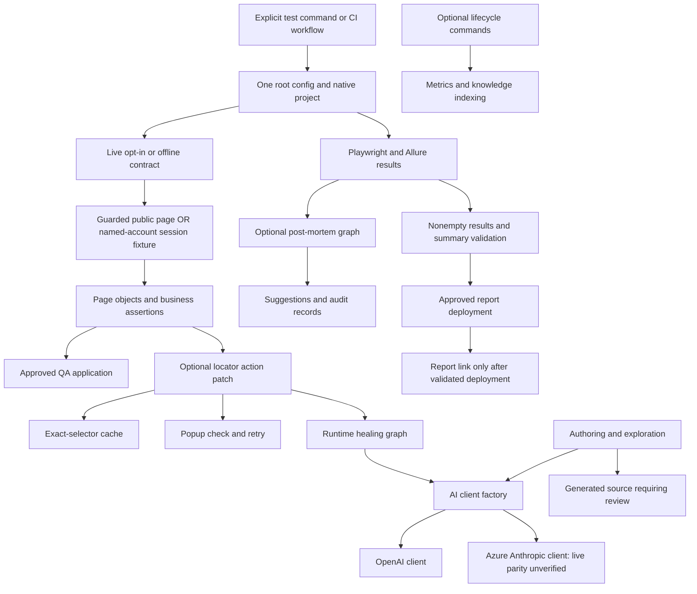

# Multi-Agent AI QA Framework: Current Architecture Report

Reviewed: 19 October 2026. Baseline: Keshav TN's supplied May 2026 dissertation, *Transforming Software Testing Through Multi-Agent AI: An Advanced Framework for Reducing QA Cycle Time While Maintaining Quality*.

Operational reconciliation updated 5 November 2026 for the single-config revamp.
The dated research findings and test evidence below retain their original scope.
This documentation/customization update ran no terminal tests and establishes no
new live QA, provider, cloud, Slack or deployment verification.

This revision uses the dissertation as the source for the research purpose, terminology, and six-phase lifecycle. Current source code determines implementation claims. Where the two disagree, the difference is recorded rather than changing working code to fit an older description. This is a source review, not a new live benchmark or a replacement for the signed academic certificate.

Read [PROJECT_GUIDE.md](PROJECT_GUIDE.md) for the plain-language walkthrough and interview preparation. The [README](../README.md) is the operational entry point. Older dated documents and screenshots are historical evidence, not current guarantees.

Start with [FRAMEWORK_NAVIGATION_GUIDE.md](FRAMEWORK_NAVIGATION_GUIDE.md) for short
onboarding, named accounts and old-to-new commands/paths. One repository-shared
`framework-maintainer` Copilot agent and five task prompts support development;
these are separate from runtime AI agents and do not form a security sandbox.

## 1. Introduction and Scope

The problem is maintenance effort caused by changed UI locators, asynchronous rendering, and hard-to-diagnose failures. The design combines ordinary Playwright tests with optional AI assistance for locator repair, failure investigation, and test authoring. The intended outcome is faster diagnosis and less repetitive maintenance without weakening business assertions.

The primary application is Total Connect 2.0 QA. The repository also contains AlarmNet negative-login observations, demo shopping flows, and disabled Total Connect performance specifications. These are separate test surfaces, not one homogeneous smoke suite.

Technologies include Playwright, JavaScript/Node.js, LangGraph, OpenAI, an evolving Azure AI Foundry Anthropic-compatible client, Allure, LambdaTest, GitHub Actions, and Slack. Chroma-compatible storage and local JSON vector storage support optional knowledge indexing. There is no implemented Appium or MCP server in the reviewed framework source.

An AI suggestion is not a verified fact. A passing UI action is not proof of the intended business result. Assertions, review, reproducible evidence, and application-specific safety rules remain necessary.

## 2. Dissertation Reconciliation

| Report statement or omission | Current evidence and corrected wording |
|---|---|
| Abstract describes Proxy wrappers; section 3.1 says they were replaced | The Total Connect fixture patches page locator factories and locator methods in place. A separate page Proxy remains and is used by the demo AI fixture. Do not say all Proxy code was removed. |
| Exactly two primary graphs / six agents | Five graph builders exist: runtime, post-mortem, lifecycle, exploration, and NL authoring. Six conceptual agent roles remain, plus separate registry-healing and registry-spec-generation modules. Not every module runs on every test. |
| Seven-second timeout always leaves enough repair time | Seven seconds is injected only for supported methods without an explicit timeout. Test, browser, API, and retry timeouts remain independent; no deadline-aware repair budget is enforced. |
| Hard maximum of three repair attempts | Default `maxRetries` is 3, but the interceptor supplies `maxRetries + 1`. Routing can reach a fourth attempt with strategy `exhausted`. Bounded does not mean exactly three. |
| All failures or assertions are repaired transparently | Only listed action methods on patched locators are intercepted. `expect` assertions, page-level actions, `setChecked`, and frame-derived locators are not universally intercepted. Smoke login happens before patching. |
| Historical repairs are retrieved into every repair prompt | Indexing, embeddings, a query helper, and optional prompt fields exist. The live healer does not invoke semantic retrieval or supply `ragContext`. Runtime reuse currently comes from the exact-selector cache. |
| Phase 3 opens a browser to validate drift candidates | Lifecycle pre-execution reads source and counts locators for up to three candidates. The separate drift CLI/agent performs live-page comparison. |
| Strategy prioritizes regression execution | It prioritizes drift candidates; the full lifecycle command still invokes Playwright without a risk-selected test list. |
| Test-case healing reads AST dependencies | It uses regular expressions to follow local `require()` imports and one additional dependency level, not a full syntax tree. |
| Human approval for every permanent repair | Runtime healing leaves source unchanged; post-mortem produces suggestions. Separate registry healing can write registry/page-object files. Authoring/exploration also write files. Approval is not universally enforced. |
| Passing tests have zero cost and zero overhead | An action that succeeds immediately does not request locator-healing inference. Browser execution, wrappers, reporting, and optional authoring/strategy/indexing still have cost. A finally passing test can have consumed AI calls. |
| Under 1,000 ms healing; absolute accuracy; eliminated hallucinations | These are not supported guarantees. Measure latency and false-heal rate. Reduced DOM context narrows suggestions but cannot establish semantic correctness. |
| Page 18 repairs a username field to `#UsernameInput` | The supplied demonstration is a Cameras mutation. Its screenshot shows `#menu-CamerasMenu`; the username narrative contradicts that evidence. |
| Five tests / 8.9-second baseline establishes current performance | Current smoke has eight tests and different account/data checks. Historical runs do not establish current duration or cycle-time savings. |
| Camera names establish loaded feeds | Current code distinguishes inventory from rendered player sections. It does not prove streaming playback, frame progression, or recording correctness. |
| Native CI/CD and multimodal work are wholly future scope | GitHub Actions, publishing, artifacts, Slack, and screenshot-assisted failure analysis exist. Automatic repair PRs and visual locator healing remain future work. |
| Secrets come only from environment variables | The October review found literal fallbacks. The November contract resolves named accounts from ignored `.env.qa` or CI secrets with no literal credentials. Legacy variable aliases are conditional, not credential defaults. Historical exposure still needs owner review; do not reproduce values. |
| Only OpenAI is supported | OpenAI and Azure Anthropic-compatible routing are retained for explicit local AI use. Live parity is unverified; OpenAI-specific embedding/RAG work remains incomplete. Do not equate route availability with end-to-end parity. |
| Every repair has complete correlation evidence | Post-mortem uses run/failure IDs. Runtime events have a generic title; cache recoveries are not equivalently logged. Full action-to-test-to-run linkage is incomplete. |

Evidence: [fixture](../framework/ai/fixtures/tc.ai.fixture.js), [interceptor](../framework/ai/core/locator-proxy.js), [routing](../framework/ai/graph/conditions.js), [lifecycle nodes](../framework/ai/graph/lifecycle-nodes.js), [test-case healer](../framework/ai/agents/test-case-healer.agent.js), [provider factory](../framework/ai/core/ai-client-factory.js), [registry healer](../framework/ai/agents/healer-agent.js).

## 3. Architecture and Ownership

### One Runner, Explicit Ownership

| Owner | Responsibility |
|---|---|
| [package.json](../package.json) | Available commands; many old demo and authoring aliases were removed. |
| [playwright.config.js](../playwright.config.js) | Six native projects, disjoint discovery, retries zero, runner/fixture-page options and raw reporters; no import-time env/provider loading or old global cleanup. |
| [environment.js](../framework/config/environment.js), [accounts.js](../framework/config/accounts.js) | Explicit env loading and named credential resolution at authenticated execution, never test collection. |
| [runtime.config.js](../framework/config/runtime.config.js) | Compatibility settings API for remaining callers; not another Playwright config or credential store. |
| [test-data.config.js](../framework/config/test-data.config.js) | Target URLs, test data, exploration settings. |
| [ai.config.js](../framework/ai/config/ai.config.js) | AI flags, models, thresholds, retry and DOM limits. |
| [browser-launcher.js](../framework/utils/browser-launcher.js) | Helper-created local/cloud sessions and context timeouts. |
| [tc.fixture.js](../framework/fixtures/tc.fixture.js) | Live guard, named-account authenticated session/page, 180-second fixture budget, cleanup and safe artifacts; guarded public page stays unauthenticated. |
| [smoke.fixture.js](../framework/fixtures/smoke.fixture.js) | Named test-scoped POMs and optional healing before locator construction. |

`smoke.fixture` intentionally owns named POMs over `tc.fixture` session lifecycle.
Do not add aliases or duplicate session owners. Canonical POMs live in
`framework/pages/tc2/`; old generated/smoke modules are transitional thin re-exports.
Manual authenticated browsers consume passed headless/channel/action/navigation
settings; artifact capture remains explicitly fixture-owned. Native `--headed`
works through this forwarding, not automatic inheritance by manual contexts.

Projects are `tc2`, `monitoring`, `alarmnet-login-security`,
`alarmnet-mobile-security`, `alarmnet-forgot-login-security`, and `framework`.
The root default test timeout is 90 seconds and retries are zero. `tc2` and
`monitoring` use one worker; smoke is not fully parallel. Security commands select
five workers. Smoke setup is 180 seconds, panel tests 300 seconds, camera tests
90 seconds. These are budgets, not measured timings. Routine tests use native tags
in an existing project folder, without config/YAML edits.

`getAccount(name)` accepts `^[a-z][a-z0-9_]*$` and resolves
`ACCOUNT_<UPPER_NAME>_USERNAME/PASSWORD`. Default `approved_monitor` is mandatory
for `@panel`; non-panel tests can use `test.use({ account: 'secondary' })`.
Only ignored `.env.qa` or CI secrets hold values; the committed template is blank.
Legacy `LOGIN_MONITOR_*` / `TC_*` map to `approved_monitor` / `configured` only if
the entire corresponding canonical pair is absent. Empty/partial pairs fail.
No credentials in config/specs/prompts, no provider loading at root import time,
and no authenticated fixture or credentials for public tests.

## 4. Execution and Current Coverage

### Smoke Path

1. Use `npm run test:smoke` for the `tc2` project and native `@smoke` selection, only after live/panel approval. `npm test` is offline Node validation.
2. The live fixture guard requires `RUN_LIVE_TESTS=true` (set by the script) before network/account use. Shared CI owns isolated current-run outputs; local report cleanup is deliberate, not a root global setup side effect.
3. Each test resolves `approved_monitor` from canonical account variables, with the conditional legacy-name compatibility described above. `@panel` cannot select another account.
4. The helper launches a fresh browser/context, handles consent, logs in, waits for the home URL, then waits for Devices content. Setup failures clean up acquired resources.
5. Explicit local AI can patch eligible non-panel interactions before page-object construction; never generically heal/replay physical actions. Normal CI has healing off and no rerun.
6. Eight independent tests check state/navigation; each fixture teardown closes its browser. The physical panel remains shared, so single-worker execution and test-owned disarm cleanup remain mandatory.
7. Reporters collect results; shared CI validates nonempty results/summary, publishes eligible reports, and supplies Slack links only after validated deployment. Failed/incomplete runs are not passes.

Source: [smoke suite](../tests/tc2/smoke-suite.spec.js), [login helper](../framework/utils/login-session.js), [shared execution](../.github/workflows/test-execution.yml).

Fixture adoption increases smoke login attempts from one per successful suite to one per test; it does not introduce authentication-state caching. See the [fixture assessment](PROJECT_GUIDE.md#fixture-reuse-assessment-27-october-2026) for measured source changes and offline checks. The login/logout monitor reuses session ownership without changing its logout/recovery workflow. Security uses a separate unauthenticated fixture for pacing and optional POM construction. Existing demo fixtures share artifact capture, with raw HTML remaining an explicit legacy opt-in.

| Test | Current assertion boundary |
|---|---|
| TC-001 | Home path, navigation controls, password field hidden; not panel availability. |
| TC-002 | All visible partitions reach Disarmed, Armed Home, then Disarmed; selection refreshed, disarm attempted in `finally`. |
| TC-003 | At least one visible device-category label; not every device's operation. |
| TC-004 | Cameras route, iframe, visible Cameras heading. |
| TC-005 | Events route and a timestamped entry; not proof that this test's command produced that event. |
| TC-006 | Nonempty modern live-camera inventory with every discovered card visible; no fixed names or count. |
| TC-007 | Nonempty visible names on each live card; renames and duplicates are allowed. |
| TC-008 | Rendered feed sections; not playback. |

Smoke uses dynamic inventory rather than expected camera names or a fixed count. It waits for at least one modern live card, discovers the current count for each check, and checks each card's visible name and, for TC-008, its own feed section. Inventory additions, removals, and renames are allowed; empty inventory, hidden cards, blank names, and missing per-card feed sections fail. DOM-only discovery cannot identify omitted backend cameras or prove inventory completeness; backend device IDs would be required for that contract. Fixed-count and explicit-name modes remain available to other callers, with older-UI fallback in the explicit-name mode. Camera content is in an iframe, a separate document accessed through a frame locator.

On failure, the camera fixture captures state before closing the authenticated session: current labels, feed text, a filtered live-section DOM (maximum 16,000 characters), and a cropped screenshot. Missing sections produce unavailable-state evidence; capture exceptions are annotated without masking failures. Optional post-failure AI analysis receives scoped evidence. Capture and name verification make no AI calls; suggestions are not verified repairs. Generate local Allure reports after execution and optional augmentation; root raw reporting is not an automatic AI-finalization barrier.

The [home page object](../framework/pages/tc2/TotalConnectHomePage.js) uses `setChecked(true)` for individual partitions when available, supports SELECT ALL fallback, handles mixed-state disarm, observes pending states, and surfaces rejected commands/offline-panel errors. Preserve `ensureDisarmed`, partition selection, arm/status inside `try`, re-selection/disarm inside `finally`, then Disarmed verification. It does not intentionally retry physical commands. CI/runner retries are zero; generic AI replay is prohibited for physical actions. Hard cancellation can prevent cleanup, so exactly-once execution/restoration is not guaranteed and an operator check may be needed.

### Other Lanes

| Lane | Implementation and boundary |
|---|---|
| Offline checks | `npm test` for Node checks; `npm run test:framework:browser` for synthetic fixture contracts. Neither reaches live QA. |
| Login/logout and recovery monitor | Root `monitoring` project: one worker, no retries, default 20 repetitions per test; environment setting 1-100. Recovery is public and does not submit a reset. Use finite native repetitions. |
| Negative-login observation | Three root AlarmNet projects: synthetic credentials, no account/provider loading, separate test outputs and masked input screenshots. Live request-rate approval is still required. |
| Clip export | [Spec](../tests/tc2/export-clip.spec.js): account-specific camera ID, timeline coordinates, export clicks; no downloaded-file or backend-completion assertion. |
| Demo flows | [App fixture](../framework/fixtures/app.fixture.js) and auth/cart/checkout/order flows demonstrate reuse on another app, not TC coverage. |
| Older performance specs | Files under the Total Connect test directory end in `.disabled`; they are not active normal-suite coverage. |

## 5. Runtime Healing

The TC fixture patches locator-producing page methods. The same Locator object is retained for matcher compatibility. Chained methods such as `first` and `filter` return patched locators. The [page Proxy](../framework/ai/core/page-proxy.js) remains a separate path.

When a supported action throws a recognized timeout, missing-element, or strictness error:

1. Reject recursive healing using a page-level guard.
2. Look up a replacement by original-selector description. Cache reuse happens after failure, not before the initial action.
3. Invalidate a cached replacement if its action fails.
4. Try popup dismissal and retry the original action.
5. Invoke the graph, advancing strategy hints through CSS, role, and text.
6. Extract bounded DOM and targeted candidates; request structured AI suggestions.
7. Filter low-confidence candidates, construct supported locators, check matches, and execute the original action against a candidate.
8. Return that action's result without executing it a second time merely because healing succeeded.
9. Otherwise propagate the original error; always clear the recursion guard.

Default suggestion threshold: 0.5. Cache writes require at least 0.9 confidence; reuse requires two recorded successes and an entry younger than seven days. These are heuristics, not calibrated probabilities. Cache keys do not include application/account identity. Cached recovery does not generate the same event record as model-driven recovery.

Raw locator factories allow repair without recursive interception. Not all Playwright APIs or iframe locators are patched. A presence check returning false does not throw and therefore does not inherently trigger repair. Assertion expectations are not automatically rewritten.

Source: [locator patch](../framework/ai/core/locator-proxy.js), [healer](../framework/ai/agents/locator-healer.agent.js), [cache](../framework/ai/storage/healing-cache.js), [runtime graph](../framework/ai/graph/runtime-graph.js).

## 6. Post-Mortem and Human Review

The [AI reporter](../framework/ai/reporters/ai-healing-reporter.js) observes `failed` and `timedOut`, combines errors and nested step titles, and starts analysis after each failing attempt. It waits for pending analysis at run end. Post-mortem does not necessarily mean after the entire suite.

The analyzer reads source/errors and optionally a screenshot; vision failure falls back to text. The [healing graph](../framework/ai/graph/healing-graph.js) routes locator/logic categories to suggested changes and network/timeout/unknown categories to report-only. Even `app_bug` can reach suggestions; reviewers must reject proposals that conceal application defects.

The test-case healer neither applies suggestions nor reruns the test. An audit label such as `healing_succeeded` can mean a suggestion was produced, not that a repair was verified. Permanent edits and changed expectations need review.

The reporter/graph does not consistently enforce separate `failureAnalysis` and `testCaseHealing` flags. A runtime-evidence injection helper is defined but not called by the current `onEnd` path. Do not promise attachments on every passing healed test. Some aggregate counters omit `timedOut` even though it triggers analysis.

## 7. Six-Phase Lifecycle and Agent Roles

| Phase | Current behavior |
|---|---|
| Discovery | Scan source inventory; approximate import coverage by name matches, not requirements coverage. |
| Strategy | AI risk assessment using inventory/history; choose drift candidates. |
| Pre-execution | Read up to three candidate sources and count locators; no live browser here. |
| Execution | Playwright runs outside the lifecycle graph. |
| Runtime recovery | Independent runtime graph where interception is installed/enabled. |
| Synthesis | Compute metrics, optionally index recent repairs, write report. |

Pre/post commands are separate invocations. The saved checkpoint is a summary, not durable resumption of a browser workflow. The full lifecycle npm chain uses success-only separators, so test failure can prevent synthesis. It explicitly enables AI only for the test segment; configure pre/post environment deliberately.

Six conceptual roles remain: locator healer, failure analyzer, test-case healer, drift detector, flaky-test analyzer, explorer. These are modules/prompts coordinated by code, not six continuously running independent processes. Flaky analysis interprets history but does not independently verify unchanged application/environment conditions. Separate live drift analysis does not automatically repair tests.

## 8. Authoring, Exploration, and Registries

| Route | Behavior |
|---|---|
| Preview | AI parses instructions; prints a template and saves a Markdown report; no browser. |
| Existing-page-API generator | Fixed API description prompts code generation; writes a spec; optional `--run`. No correctness guarantee. |
| Full NL graph | Parse, launch/login, resolve steps against DOM, execute generated code/fallback, record actions/assertions, generate/write artifacts. |
| Exploration graph | Crawl within limits, capture structure, classify/analyze, generate page objects/tests, write files. |
| Registry generation | Read structured selector inventories and Markdown scenarios to generate source. |
| Registry validation/healing | Inspect selectors and optionally repair registry/page-object source; distinct from in-memory runtime repair. |

Full NL authoring uses `new Function` to execute generated JavaScript; this is not a sandbox. Use approved environments, reviewed input, and restricted credentials. Failed recorded steps can still be followed by artifact generation. Cached DOM snapshots require invalidation and are not application truth.

The generator API description and [.github/copilot-instructions.md](../.github/copilot-instructions.md) are maintained separately from POM code; check for drift before generation. New TC2 output uses `tests/tc2/nl-authored/`, named POM fixtures, native `@nl-authored`/`@regression` tags, and preserves the eight smoke assertions. Never overwrite human-maintained specs silently. The one maintainer agent and five task prompts reference this shared contract; they guide generation rather than enforcing it mechanically. Live/public, panel, paid AI, cloud, Slack and deployment actions require explicit approval independently of authoring permission.

Source: [preview](../framework/ai/scripts/nl-author-preview.js), [generator](../framework/ai/scripts/nl-author-generate.js), [NL nodes](../framework/ai/graph/nl-authoring-nodes.js), [exploration graph](../framework/ai/graph/exploration-graph.js), [registry generator](../framework/ai/agents/spec-generator.js).

## 9. Providers, Knowledge, and Metrics

### Providers

OpenAI defaults: `gpt-4o-mini` for healing and `gpt-4o` for analysis. JSON and screenshot-analysis clients exist. The common factory can select Azure AI Foundry through an Anthropic Messages endpoint, `x-api-key`, version header, timeout, retries/backoff, and JSON extraction.

Azure requires `AZURE_ANTHROPIC_ENDPOINT`, `AZURE_ANTHROPIC_API_KEY`, and `AZURE_ANTHROPIC_MODEL`. It is not Azure OpenAI under another name. The October review identified OpenAI-only guards/model overrides; the November revamp retains optional provider-aware local routing with lazy initialization. This does not establish live entry-point parity for keys, models, metrics or errors. Separate router/factory experiments and OpenAI-specific embedding consumers remain; do not use dummy secrets as a workaround or describe all routes as interchangeable.

### Knowledge Store

The indexer supports healing events, failure reports, page objects, and test specs. Embeddings use OpenAI; JSON storage does not make embedding generation offline/free. The store attempts a Chroma client and has a JSON cosine-similarity fallback. Installing the dependency does not establish a working production Chroma service. No runtime retriever currently connects this index to healing prompts.

### Metrics

The [metrics engine](../framework/ai/metrics/metrics-engine.js) computes:

- `Pass@k`: fraction of grouped healing sessions with an applied event in the first k events; not a formal independent-sampling estimator.
- `SHE`: applied healing events divided by recorded tests with status `failed`.
- Latency: mean, median, p95/p99, counts, per-method aggregates.
- Confidence threshold summaries from recorded events.

Grouping uses adjacent matching selectors within 60 seconds, not unique run/test/failure IDs. Recovered tests may pass and disappear from the SHE denominator; `timedOut` is excluded; cache recoveries are under-recorded. SHE can exceed 1 or be 0 despite recoveries when no final failures exist. Do not call it a validated percentage of recoverable failures.

Cost tracking estimates price from usage and model pricing; it is not a provider invoice. Latency wrappers can include retries/waiting. The reporter resets cost records per run. Savings claims need consistent run scope, complete instrumentation, and independently reviewed results.

## 10. Reporting, Cloud, and CI/CD

The root runner writes raw Allure results. Local generation is explicit; the optional timestamped auto-reporter is not the shared CI publisher. HTML, screenshots, JSON diagnostics and AI records serve different purposes. Manual sessions own artifact capture. Generate reports after execution/optional AI augmentation; report availability alone does not prove complete evidence.

Shared CI validates nonempty parseable test records and the generated summary before publishing current-run results. Valid failed-test reports can publish; metadata-only, corrupt or zero-result outputs cannot replace latest. Preserve raw evidence where the runner remains available and retain failed/timed-out/incomplete execution state even when partial counts pass. Slack supports multiple summary layouts, but CI must not use archive fallback as current evidence; supply a report URL only after validated deployment.

LambdaTest uses `chromium.connect()` with WebSocket capabilities; the endpoint's `cdp` hostname does not mean the code calls `connectOverCDP()`. Manual cloud sessions request a 1920x1080 viewport; separate tooling updates status. Remote execution is implemented, not demonstrated parallel scalability.

Thin trigger wrappers call [test-execution.yml](../.github/workflows/test-execution.yml):

- [General Playwright](../.github/workflows/playwright.yml) and [daily smoke](../.github/workflows/smoke-daily.yml).
- [Login/recovery](../.github/workflows/login-monitor.yml) and [login/logout](../.github/workflows/login-logout.yml).
- [AlarmNet Sign In](../.github/workflows/alarmnet-login-security.yml), [Mobile](../.github/workflows/alarmnet-mobile-security.yml), and [Forgot Login](../.github/workflows/alarmnet-forgot-login-security.yml); the [legacy security runner](../.github/workflows/alarmnet-security-runner.yml) is a compatibility wrapper.

All CI suites execute once, retries zero and no healing rerun. Explicit monitor/security repetitions are not failure retries. CI allowlists suite/account secret bindings and maps existing monitor secret names to canonical variables; public security receives no account secrets. Shared concurrency protects panel/account execution and Pages writes; hard cancellation can still prevent cleanup/upload. A schedule is not proof of approved request rates or successful execution.

Publishing retains versioned run paths and a latest pointer, not a choice between original and healing-run results. Routine tests need no workflow edit; only schedules/policies do. Optional local lifecycle chains can still skip later work on failure, so do not treat those tools as the shared CI executor.

## 11. Evaluation and Remaining Work

The supplied report demonstrates a locator mutation and historical screenshots, not controlled proof of absolute accuracy or quantified engineer-hour savings. For numerical claims, record commit, suite, account/location class, browser/platform, repetitions, retries, AI/cache settings, and run IDs.

Compare unchanged tests with AI off/on, controlled mutations with AI off/on, and genuine defects with healing on. Manually label correct versus false recovery. Measure unrecovered defects, wall time including setup, AI time/cost, and human diagnosis/repair time. Separate cache/model results. Use multiple runs and disclose sample size and variability.

Priorities after the revamp: explicitly approved live acceptance of panel cleanup, account/CI gates and provider parity; historical secret-exposure/redaction review; durable event IDs and correct metric denominators; validated retrieval; reviewed permanent repairs and generated-code isolation. No software path guarantees cleanup/report delivery after hard runner termination. Visual locator repair, repair PRs, Appium, backend telemetry, and production-journey prioritization remain extension opportunities.

This revision checks source/document consistency without contacting QA, cloud browsers, AI providers, or Slack. It does not certify live performance, deployed workflows, or provider connectivity.

Verification on 19 October 2026: 34 existing offline Node tests passed across synthetic page-object checks, cookie-consent handling, and mocked Slack messages. Synthetic routing/metric probes confirmed the fourth-attempt and SHE-denominator limitations described above. Documentation checks verified local source links and README npm command names. No live application or AI-provider tests were run.

## 12. References and Academic Presentation

Verify the dissertation bibliography's author names, titles, dates, venues, and links against original publications. The 40%, 60%, and 84% statements need precise sources/context; they are not repository measurements. Deterministic graph routing does not imply deterministic AI output.

For a revised submission, rebuild the contents with page numbers, use unique chapter-based figure numbers, start chapter pagination as required, reconcile the Cameras narrative, and add measured results/limitations. Check the final rendered document before completing its checklist. Existing signatures and certification text have not been changed.