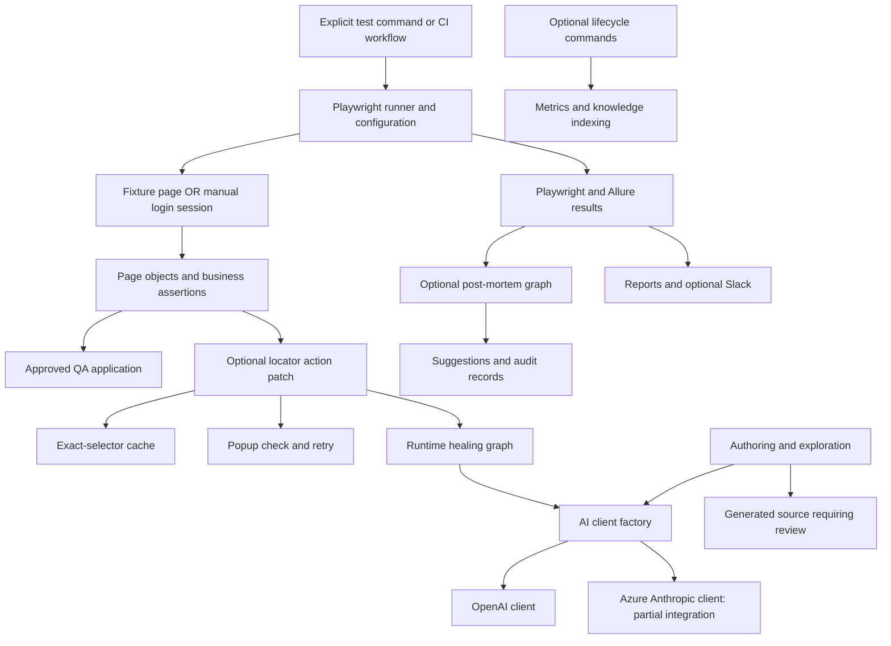

# Multi-Agent AI QA Framework: Current Architecture Report

Reviewed: 19 October 2026. Baseline: Keshav TN's supplied May 2026 dissertation, *Transforming Software Testing Through Multi-Agent AI: An Advanced Framework for Reducing QA Cycle Time While Maintaining Quality*.

This revision uses the dissertation as the source for the research purpose, terminology, and six-phase lifecycle. Current source code determines implementation claims. Where the two disagree, the difference is recorded rather than changing working code to fit an older description. This is a source review, not a new live benchmark or a replacement for the signed academic certificate.

Read [PROJECT_GUIDE.md](PROJECT_GUIDE.md) for the plain-language walkthrough and interview preparation. The [README](../README.md) is the operational entry point. Older dated documents and screenshots are historical evidence, not current guarantees.

## 1. Introduction and Scope

The problem is maintenance effort caused by changed UI locators, asynchronous rendering, and hard-to-diagnose failures. The design combines ordinary Playwright tests with optional AI assistance for locator repair, failure investigation, and test authoring. The intended outcome is faster diagnosis and less repetitive maintenance without weakening business assertions.

The primary application is Total Connect 2.0 QA. The repository also contains AlarmNet negative-login observations, demo shopping flows, and disabled Total Connect performance specifications. These are separate test surfaces, not one homogeneous smoke suite.

Technologies include Playwright, JavaScript/Node.js, LangGraph, OpenAI, an evolving Azure AI Foundry Anthropic-compatible client, Allure, LambdaTest, GitHub Actions, and Slack. Chroma-compatible storage and local JSON vector storage support optional knowledge indexing. There is no implemented Appium or MCP server in the reviewed framework source.

An AI suggestion is not a verified fact. A passing UI action is not proof of the intended business result. Assertions, review, reproducible evidence, and application-specific safety rules remain necessary.

## 2. Dissertation Reconciliation

| Report statement or omission | Current evidence and corrected wording |
|---|---|
| Abstract describes Proxy wrappers; section 3.1 says they were replaced | The Total Connect fixture patches page locator factories and locator methods in place. A separate page Proxy remains and is used by the demo AI fixture. Do not say all Proxy code was removed. |
| Exactly two primary graphs / six agents | Five graph builders exist: runtime, post-mortem, lifecycle, exploration, and NL authoring. Six conceptual agent roles remain, plus separate registry-healing and registry-spec-generation modules. Not every module runs on every test. |
| Seven-second timeout always leaves enough repair time | Seven seconds is injected only for supported methods without an explicit timeout. Test, browser, API, and retry timeouts remain independent; no deadline-aware repair budget is enforced. |
| Hard maximum of three repair attempts | Default `maxRetries` is 3, but the interceptor supplies `maxRetries + 1`. Routing can reach a fourth attempt with strategy `exhausted`. Bounded does not mean exactly three. |
| All failures or assertions are repaired transparently | Only listed action methods on patched locators are intercepted. `expect` assertions, page-level actions, `setChecked`, and frame-derived locators are not universally intercepted. Smoke login happens before patching. |
| Historical repairs are retrieved into every repair prompt | Indexing, embeddings, a query helper, and optional prompt fields exist. The live healer does not invoke semantic retrieval or supply `ragContext`. Runtime reuse currently comes from the exact-selector cache. |
| Phase 3 opens a browser to validate drift candidates | Lifecycle pre-execution reads source and counts locators for up to three candidates. The separate drift CLI/agent performs live-page comparison. |
| Strategy prioritizes regression execution | It prioritizes drift candidates; the full lifecycle command still invokes Playwright without a risk-selected test list. |
| Test-case healing reads AST dependencies | It uses regular expressions to follow local `require()` imports and one additional dependency level, not a full syntax tree. |
| Human approval for every permanent repair | Runtime healing leaves source unchanged; post-mortem produces suggestions. Separate registry healing can write registry/page-object files. Authoring/exploration also write files. Approval is not universally enforced. |
| Passing tests have zero cost and zero overhead | An action that succeeds immediately does not request locator-healing inference. Browser execution, wrappers, reporting, and optional authoring/strategy/indexing still have cost. A finally passing test can have consumed AI calls. |
| Under 1,000 ms healing; absolute accuracy; eliminated hallucinations | These are not supported guarantees. Measure latency and false-heal rate. Reduced DOM context narrows suggestions but cannot establish semantic correctness. |
| Page 18 repairs a username field to `#UsernameInput` | The supplied demonstration is a Cameras mutation. Its screenshot shows `#menu-CamerasMenu`; the username narrative contradicts that evidence. |
| Five tests / 8.9-second baseline establishes current performance | Current smoke has eight tests and different account/data checks. Historical runs do not establish current duration or cycle-time savings. |
| Camera names establish loaded feeds | Current code distinguishes inventory from rendered player sections. It does not prove streaming playback, frame progression, or recording correctness. |
| Native CI/CD and multimodal work are wholly future scope | GitHub Actions, publishing, artifacts, Slack, and screenshot-assisted failure analysis exist. Automatic repair PRs and visual locator healing remain future work. |
| Secrets come only from environment variables | Some legacy configuration has fallback credentials. Do not reproduce them; remove fallbacks and review exposure before production use. Current smoke requires explicit approved-account variables. |
| Only OpenAI is supported | The common factory supports `AI_PROVIDER=azure`, but OpenAI-key checks and caller model overrides prevent treating this as a completed provider-independent migration. |
| Every repair has complete correlation evidence | Post-mortem uses run/failure IDs. Runtime events have a generic title; cache recoveries are not equivalently logged. Full action-to-test-to-run linkage is incomplete. |

Evidence: [fixture](../framework/ai/fixtures/tc.ai.fixture.js), [interceptor](../framework/ai/core/locator-proxy.js), [routing](../framework/ai/graph/conditions.js), [lifecycle nodes](../framework/ai/graph/lifecycle-nodes.js), [test-case healer](../framework/ai/agents/test-case-healer.agent.js), [provider factory](../framework/ai/core/ai-client-factory.js), [registry healer](../framework/ai/agents/healer-agent.js).

## 3. Architecture and Ownership

### Configuration Is Layered

| Owner | Responsibility |
|---|---|
| [package.json](../package.json) | Available commands; many old demo and authoring aliases were removed. |
| [playwright.config.js](../playwright.config.js) | Projects, discovery, runner retries, fixture-page options, reporters, global cleanup. |
| [runtime.config.js](../framework/config/runtime.config.js) | Shared environment-derived settings for consumers that import it. |
| [test-data.config.js](../framework/config/test-data.config.js) | Target URLs, test data, exploration settings. |
| [ai.config.js](../framework/ai/config/ai.config.js) | AI flags, models, thresholds, retry and DOM limits. |
| [browser-launcher.js](../framework/utils/browser-launcher.js) | Manual local/cloud sessions and context timeouts. |

There is no universally enforced timeout/configuration object. Runner `use` settings do not automatically configure manual contexts. Explicit method options override defaults. This also affects screenshots, trace, video, and `--headed` behavior for manually launched browsers.

The main runner uses one worker, local test timeout 90 seconds, cloud test timeout 120 seconds, and CI retries 2. Fixture action timeouts are 30/45 seconds local/cloud; navigation is 60/45 seconds. The manual launcher uses action timeouts 30/45 seconds and navigation 90/60 seconds. Smoke setup is 180 seconds, panel test 300 seconds, camera tests 90 seconds.

## 4. Execution and Current Coverage

### Smoke Path

1. Select `tc-smoke` explicitly to avoid overlapping project discovery.
2. Main global setup removes shared current Allure results/report, not timestamped history.
3. Smoke setup requires `LOGIN_MONITOR_USERNAME` and `LOGIN_MONITOR_PASSWORD`; it does not silently choose the older account.
4. The helper launches a browser, handles consent, logs in, waits for the home URL, then waits for Devices content.
5. Optional healing patches the authenticated page before page-object construction.
6. Eight tests check state/navigation; teardown closes the browser.
7. Reporters collect results; configured CI steps publish reports and send notifications.

Source: [smoke suite](../tests/generated/smoke/smoke-suite.spec.js), [login helper](../framework/utils/login-session.js), [global setup](../global-setup.js).

| Test | Current assertion boundary |
|---|---|
| TC-001 | Home path, navigation controls, password field hidden; not panel availability. |
| TC-002 | All visible partitions reach Disarmed, Armed Home, then Disarmed; selection refreshed, disarm attempted in `finally`. |
| TC-003 | At least one visible device-category label; not every device's operation. |
| TC-004 | Cameras route, iframe, visible Cameras heading. |
| TC-005 | Events route and a timestamped entry; not proof that this test's command produced that event. |
| TC-006 | Every configured camera is visible in live inventory, with older-UI fallback. |
| TC-007 | Camera names through inventory verification; overlaps TC-006. |
| TC-008 | Rendered feed sections; not playback. |

Smoke supplies eight expected camera names. The camera page object's older default inventory differs, so callers must select inventory for their approved account/location. Camera content is in an iframe, a separate document accessed through a frame locator.

The [home page object](../framework/pages/generated/smoke/TotalConnectHomePage.js) uses `setChecked(true)` for individual partitions when available, supports SELECT ALL fallback, handles mixed-state disarm, observes pending states, and surfaces rejected commands/offline-panel errors. It does not intentionally retry physical commands itself. Generic AI interception and whole-test retries can still repeat actions; exactly-once execution is not guaranteed.

### Other Lanes

| Lane | Implementation and boundary |
|---|---|
| Isolated smoke validation | [Configuration](../playwright.smoke-validation.config.js): local/headless, no AI/retries, separate artifacts. Still reaches real QA and can arm/disarm. |
| Login/logout and recovery monitor | [Configuration](../playwright.login-monitor.config.js): one worker, no retries, default 20 repetitions of each of two tests; supported setting 1-100. Recovery does not submit a reset. |
| Continuous monitor | [Runner](../framework/utils/run-login-monitor.js): next batch starts after completion plus default 30-second interval; test failures can continue, runner interruptions stop; optional batch limit. |
| Negative-login observation | [Configuration](../playwright.login-security.config.js): selects AlarmNet, not the older TC negative spec; five workers, synthetic credentials, no dotenv/AI, separate output, masked input screenshots. Requires authorized use and rate review. |
| Clip export | [Spec](../tests/export-clip.spec.js): account-specific camera ID, timeline coordinates, export clicks; no downloaded-file or backend-completion assertion. |
| Demo flows | [App fixture](../framework/fixtures/app.fixture.js) and auth/cart/checkout/order flows demonstrate reuse on another app, not TC coverage. |
| Older performance specs | Files under the Total Connect test directory end in `.disabled`; they are not active normal-suite coverage. |

## 5. Runtime Healing

The TC fixture patches locator-producing page methods. The same Locator object is retained for matcher compatibility. Chained methods such as `first` and `filter` return patched locators. The [page Proxy](../framework/ai/core/page-proxy.js) remains a separate path.

When a supported action throws a recognized timeout, missing-element, or strictness error:

1. Reject recursive healing using a page-level guard.
2. Look up a replacement by original-selector description. Cache reuse happens after failure, not before the initial action.
3. Invalidate a cached replacement if its action fails.
4. Try popup dismissal and retry the original action.
5. Invoke the graph, advancing strategy hints through CSS, role, and text.
6. Extract bounded DOM and targeted candidates; request structured AI suggestions.
7. Filter low-confidence candidates, construct supported locators, check matches, and execute the original action against a candidate.
8. Return that action's result without executing it a second time merely because healing succeeded.
9. Otherwise propagate the original error; always clear the recursion guard.

Default suggestion threshold: 0.5. Cache writes require at least 0.9 confidence; reuse requires two recorded successes and an entry younger than seven days. These are heuristics, not calibrated probabilities. Cache keys do not include application/account identity. Cached recovery does not generate the same event record as model-driven recovery.

Raw locator factories allow repair without recursive interception. Not all Playwright APIs or iframe locators are patched. A presence check returning false does not throw and therefore does not inherently trigger repair. Assertion expectations are not automatically rewritten.

Source: [locator patch](../framework/ai/core/locator-proxy.js), [healer](../framework/ai/agents/locator-healer.agent.js), [cache](../framework/ai/storage/healing-cache.js), [runtime graph](../framework/ai/graph/runtime-graph.js).

## 6. Post-Mortem and Human Review

The [AI reporter](../framework/ai/reporters/ai-healing-reporter.js) observes `failed` and `timedOut`, combines errors and nested step titles, and starts analysis after each failing attempt. It waits for pending analysis at run end. Post-mortem does not necessarily mean after the entire suite.

The analyzer reads source/errors and optionally a screenshot; vision failure falls back to text. The [healing graph](../framework/ai/graph/healing-graph.js) routes locator/logic categories to suggested changes and network/timeout/unknown categories to report-only. Even `app_bug` can reach suggestions; reviewers must reject proposals that conceal application defects.

The test-case healer neither applies suggestions nor reruns the test. An audit label such as `healing_succeeded` can mean a suggestion was produced, not that a repair was verified. Permanent edits and changed expectations need review.

The reporter/graph does not consistently enforce separate `failureAnalysis` and `testCaseHealing` flags. A runtime-evidence injection helper is defined but not called by the current `onEnd` path. Do not promise attachments on every passing healed test. Some aggregate counters omit `timedOut` even though it triggers analysis.

## 7. Six-Phase Lifecycle and Agent Roles

| Phase | Current behavior |
|---|---|
| Discovery | Scan source inventory; approximate import coverage by name matches, not requirements coverage. |
| Strategy | AI risk assessment using inventory/history; choose drift candidates. |
| Pre-execution | Read up to three candidate sources and count locators; no live browser here. |
| Execution | Playwright runs outside the lifecycle graph. |
| Runtime recovery | Independent runtime graph where interception is installed/enabled. |
| Synthesis | Compute metrics, optionally index recent repairs, write report. |

Pre/post commands are separate invocations. The saved checkpoint is a summary, not durable resumption of a browser workflow. The full lifecycle npm chain uses success-only separators, so test failure can prevent synthesis. It explicitly enables AI only for the test segment; configure pre/post environment deliberately.

Six conceptual roles remain: locator healer, failure analyzer, test-case healer, drift detector, flaky-test analyzer, explorer. These are modules/prompts coordinated by code, not six continuously running independent processes. Flaky analysis interprets history but does not independently verify unchanged application/environment conditions. Separate live drift analysis does not automatically repair tests.

## 8. Authoring, Exploration, and Registries

| Route | Behavior |
|---|---|
| Preview | AI parses instructions; prints a template and saves a Markdown report; no browser. |
| Existing-page-API generator | Fixed API description prompts code generation; writes a spec; optional `--run`. No correctness guarantee. |
| Full NL graph | Parse, launch/login, resolve steps against DOM, execute generated code/fallback, record actions/assertions, generate/write artifacts. |
| Exploration graph | Crawl within limits, capture structure, classify/analyze, generate page objects/tests, write files. |
| Registry generation | Read structured selector inventories and Markdown scenarios to generate source. |
| Registry validation/healing | Inspect selectors and optionally repair registry/page-object source; distinct from in-memory runtime repair. |

Full NL authoring uses `new Function` to execute generated JavaScript; this is not a sandbox. Use approved environments, reviewed input, and restricted credentials. Failed recorded steps can still be followed by artifact generation. Cached DOM snapshots require invalidation and are not application truth.

The generator's API description and [.github/copilot-instructions.md](../.github/copilot-instructions.md) are maintained separately from page objects. They lag some additions, including stronger error handling, explicit camera inventory, and home navigation. Prompts guide generation but do not enforce contracts mechanically.

Source: [preview](../framework/ai/scripts/nl-author-preview.js), [generator](../framework/ai/scripts/nl-author-generate.js), [NL nodes](../framework/ai/graph/nl-authoring-nodes.js), [exploration graph](../framework/ai/graph/exploration-graph.js), [registry generator](../framework/ai/agents/spec-generator.js).

## 9. Providers, Knowledge, and Metrics

### Providers

OpenAI defaults: `gpt-4o-mini` for healing and `gpt-4o` for analysis. JSON and screenshot-analysis clients exist. The common factory can select Azure AI Foundry through an Anthropic Messages endpoint, `x-api-key`, version header, timeout, retries/backoff, and JSON extraction.

Azure requires `AZURE_ANTHROPIC_ENDPOINT`, `AZURE_ANTHROPIC_API_KEY`, and `AZURE_ANTHROPIC_MODEL`. It is not Azure OpenAI under another name. Fixture/reporter/CLI guards still require an OpenAI key, and callers can override Azure's model with OpenAI defaults. Separate router/factory experiments coexist. Treat routing as partially integrated until entry-point tests verify keys, models, metrics, and errors. Do not use dummy secrets as a workaround.

### Knowledge Store

The indexer supports healing events, failure reports, page objects, and test specs. Embeddings use OpenAI; JSON storage does not make embedding generation offline/free. The store attempts a Chroma client and has a JSON cosine-similarity fallback. Installing the dependency does not establish a working production Chroma service. No runtime retriever currently connects this index to healing prompts.

### Metrics

The [metrics engine](../framework/ai/metrics/metrics-engine.js) computes:

- `Pass@k`: fraction of grouped healing sessions with an applied event in the first k events; not a formal independent-sampling estimator.
- `SHE`: applied healing events divided by recorded tests with status `failed`.
- Latency: mean, median, p95/p99, counts, per-method aggregates.
- Confidence threshold summaries from recorded events.

Grouping uses adjacent matching selectors within 60 seconds, not unique run/test/failure IDs. Recovered tests may pass and disappear from the SHE denominator; `timedOut` is excluded; cache recoveries are under-recorded. SHE can exceed 1 or be 0 despite recoveries when no final failures exist. Do not call it a validated percentage of recoverable failures.

Cost tracking estimates price from usage and model pricing; it is not a provider invoice. Latency wrappers can include retries/waiting. The reporter resets cost records per run. Savings claims need consistent run scope, complete instrumentation, and independently reviewed results.

## 10. Reporting, Cloud, and CI/CD

Allure stores raw results; a custom reporter generates timestamped reports. HTML, screenshots, optional traces/videos, JSON diagnostics, and AI records serve different purposes. Manual sessions need their own artifact capture.

The auto-reporter is configured before the AI reporter, with no explicit publication barrier awaiting all AI attachments. Regenerate Allure after execution when final evidence matters. CI report stages follow test jobs. Slack supports Allure 3 root summaries, older widgets summaries, archive fallback, and raw results; confirm current-run scope to avoid stale fallback data.

LambdaTest uses `chromium.connect()` with WebSocket capabilities; the endpoint's `cdp` hostname does not mean the code calls `connectOverCDP()`. Manual cloud sessions request a 1920x1080 viewport; separate tooling updates status. Remote execution is implemented, not demonstrated parallel scalability.

Five workflows exist:

- [General Playwright](../.github/workflows/playwright.yml): configured triggers, execution, optional healing rerun, reports, publishing, notifications.
- [Daily smoke](../.github/workflows/smoke-daily.yml): weekdays at 02:00 UTC; healing job on failure.
- [Login/recovery](../.github/workflows/login-monitor.yml): manual repetitions, isolated artifacts, no healing.
- [Login/logout](../.github/workflows/login-logout.yml): manual monitor subset.
- [Negative login](../.github/workflows/login-security.yml): every ten minutes plus manual dispatch; currently AlarmNet. A schedule is not proof of execution or approved request rates.

Publishing supports versioned run paths and a latest pointer, with shared concurrency locks. Original/healing artifacts are separated; final reporting prefers the healing run rather than merging UUID results and doubling counts. Preserve both when evaluating recovery. Evaluate workflow failure propagation separately from successful report publication.

Local `execute:smoke` scripts use single `&`: sequential separators under the usual Windows npm command shell but background execution on POSIX shells. Other chains use `&&`, skipping later steps on failure. These are not universally portable, failure-safe pipelines. Prefer explicit commands and deliberate report/notification steps.

## 11. Evaluation and Remaining Work

The supplied report demonstrates a locator mutation and historical screenshots, not controlled proof of absolute accuracy or quantified engineer-hour savings. For numerical claims, record commit, suite, account/location class, browser/platform, repetitions, retries, AI/cache settings, and run IDs.

Compare unchanged tests with AI off/on, controlled mutations with AI off/on, and genuine defects with healing on. Manually label correct versus false recovery. Measure unrecovered defects, wall time including setup, AI time/cost, and human diagnosis/repair time. Separate cache/model results. Use multiple runs and disclose sample size and variability.

Priorities: action-specific no-retry policies; removing credential fallbacks and redacting DOM/logs; provider-aware guards/models; enforced flags; durable event IDs and correct metric denominators; validated retrieval; gated permanent repairs; guaranteed post-run reporting; sandboxed/reviewed generation. Visual locator repair, repair PRs, Appium, backend telemetry, and production-journey prioritization remain extension opportunities.

This revision checks source/document consistency without contacting QA, cloud browsers, AI providers, or Slack. It does not certify live performance, deployed workflows, or provider connectivity.

Verification on 19 October 2026: 34 existing offline Node tests passed across synthetic page-object checks, cookie-consent handling, and mocked Slack messages. Synthetic routing/metric probes confirmed the fourth-attempt and SHE-denominator limitations described above. Documentation checks verified local source links and README npm command names. No live application or AI-provider tests were run.

## 12. References and Academic Presentation

Verify the dissertation bibliography's author names, titles, dates, venues, and links against original publications. The 40%, 60%, and 84% statements need precise sources/context; they are not repository measurements. Deterministic graph routing does not imply deterministic AI output.

For a revised submission, rebuild the contents with page numbers, use unique chapter-based figure numbers, start chapter pagination as required, reconcile the Cameras narrative, and add measured results/limitations. Check the final rendered document before completing its checklist. Existing signatures and certification text have not been changed.